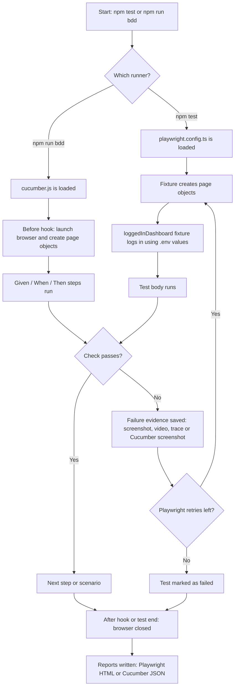
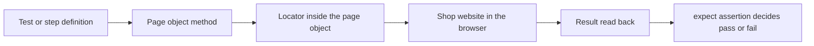

# PlaywrightWebFramework: Overview

**Written for:** team members and mentors who need to understand what this framework is for, how it is built, and how to use it.

---

## 1. Purpose

This framework automatically tests a web shop. It opens a real browser, logs in, adds products to the cart, checks the cart and checkout, and places an order. Each check is marked pass or fail, and a report is produced that anyone can open.

The shop under test is the Rahul Shetty Academy practice site (`https://rahulshettyacademy.com/client`). It is a public practice site, so it is used here to build and demonstrate automation skills safely.

The framework exists to:

- **Catch regressions early.** If a change breaks login or checkout, a failing test shows it before users do.
- **Give a single, repeatable check.** The same steps run the same way every time, on any machine with the same setup.
- **Let different people write tests.** Developers can write tests in TypeScript. Non-developers can write scenarios in plain English.
- **Be a learning and comparison project.** It shows the same tests written two ways, so they can be compared side by side.

---

## 2. What Is Being Tested

| Feature | Scenarios | What is checked |
| --- | ---: | --- |
| Login | 3 | Login fields are visible. A valid login reaches the dashboard. An invalid login shows "Incorrect email or password." |
| Products | 2 | The dashboard lists products after login. Adding "ZARA COAT 3" shows "Product Added To Cart." |
| Cart | 2 | An added product appears in the cart. The user can proceed to checkout. |
| Checkout | 2 | The country field suggests matching countries. An order can be placed and the confirmation "Thankyou for the order." appears. |

Total: **9 scenarios**. The same 9 checks are written twice, once as Playwright tests and once as Cucumber scenarios.

---

## 3. Tools and Why They Were Chosen

| Tool | Role | Why it is used |
| --- | --- | --- |
| **Playwright** | Drives the browser and runs tests | Handles waiting for page elements automatically, and produces screenshots, videos and traces on failure. |
| **TypeScript** | Programming language | Catches mistakes (such as misspelled property names) before the tests run. |
| **Cucumber (Gherkin)** | Plain-English scenarios | Lets non-developers read and write tests in Given/When/Then sentences. |
| **dotenv** | Loads the `.env` file | Keeps the test account password out of source code. |
| **ts-node** | Runs TypeScript directly | Lets Cucumber run the TypeScript step code without a build step. |
| **cucumber-html-reporter** | Creates an HTML report from Cucumber results | Gives a readable report for Cucumber runs. |

---

## 4. How the Framework Is Organized

```
config/config.json          Settings: base URL, browser, headless mode, timeouts, retries
.env                        Test account email and password (secret, never committed)
.env.example                The same variable names with placeholder values (committed)

src/
  pages/                    One class per screen of the shop
    BasePage.ts             Code shared by all pages (waiting for toast messages)
    LoginPage.ts            Email, password and login button
    DashboardPage.ts        Product list, add to cart, open cart
    CartPage.ts             Cart items and proceed to checkout
    CheckoutPage.ts         Country, place order, confirmation message
  fixtures/
    pageFixtures.ts         Gives Playwright tests ready-made pages and a logged-in state
  utils/
    configReader.ts         Reads config.json and .env and returns typed values
  steps/                    Cucumber step definitions (the code behind each sentence)
    login.steps.ts
    product.steps.ts
    cart.steps.ts
    checkout.steps.ts
    common.steps.ts         Steps shared by more than one feature
  support/
    world.ts                Holds the browser and pages for one scenario; sets the step timeout
    hooks.ts                Opens the browser before each scenario; takes a screenshot on failure; closes the browser

features/                   Plain-English scenarios (Gherkin)
  login.feature
  products.feature
  cart.feature
  checkout.feature

tests/                      Playwright test files (same scenarios as the features)
  login.spec.ts
  products.spec.ts
  cart.spec.ts
  checkout.spec.ts

scripts/
  generateCucumberReport.js Converts the Cucumber result file into an HTML report

.vscode/settings.json       Helps the VS Code Cucumber extension find the steps
playwright.config.ts        Playwright settings (browser, retries, reports)
cucumber.js                 Cucumber settings (where features and steps live)
```

### The layers, from top to bottom

1. **Feature files and spec files** describe *what* to test (the scenarios).
2. **Step definitions and test bodies** describe *how* a step is carried out, using page objects.
3. **Page objects** hold *where* things are on the screen (locators) and *what* can be done on it.
4. **Configuration and environment** hold the settings and secrets that change between runs.

The rule that holds this together: **locators live only in page objects.** If the shop changes its HTML, only the page object needs to change, not every test.

---

## 5. How the Two Test Styles Work

### Playwright tests (`npm test`)

1. Playwright reads `playwright.config.ts`.
2. For each test, Playwright creates the page objects it needs through a fixture. The `loggedInDashboard` fixture logs in first using the `.env` credentials.
3. The test runs its steps and checks results with `expect`.
4. On failure, Playwright keeps a screenshot, video and trace, and retries the test once.
5. An HTML report is written to `test-output/playwright-report/`.

### Cucumber scenarios (`npm run bdd`)

1. Cucumber reads the `.feature` files and matches each sentence to a step definition.
2. Before each scenario, `hooks.ts` opens a browser and creates the page objects, which are stored on the scenario's `world` object.
3. Each step uses those page objects. The step that checks a result decides pass or fail.
4. After each scenario, `hooks.ts` takes a screenshot if it failed, then closes the browser.
5. A JSON result is written to `test-output/cucumber-reports/`. Run `npm run bdd:report` to make it readable as HTML.

Both styles use the same page objects and the same `.env` credentials, so a fix in one place helps both.

---

### Flowchart: one run, end to end



### Flowchart: how a test reaches the shop



## 6. Configuration and Secrets

| Setting | Where | Notes |
| --- | --- | --- |
| Base URL, browser, headless mode, timeouts, retries | `config/config.json` | Committed to git. Safe to share. |
| `TEST_USER_EMAIL`, `TEST_USER_PASSWORD` | `.env` | Git-ignored. Never commit real values. |
| Variable names and placeholders | `.env.example` | Committed, so others know what to create. |

Rules to follow:

- Quote the values in `.env`. A `#` in an unquoted value is read as the start of a comment.
- Do not put passwords in `config.json`, feature files or test code.
- Use a test account only. The tests add items to the cart and place orders on the account.

---

## 7. How to Use the Framework

### First-time setup

```bash
npm install
cp .env.example .env     # then fill in the test account values
```

### Running tests

| Command | What it does |
| --- | --- |
| `npm test` | Runs the Playwright tests and writes the HTML report |
| `npm run bdd` | Runs the Cucumber scenarios and writes the JSON result |
| `npm run bdd:report` | Turns the Cucumber JSON result into an HTML report |

### Adding a new test

**For a new scenario on an existing screen:**

1. Add a `Scenario` to the matching `.feature` file, using sentences that already exist if possible.
2. If the sentences are new, add the step definition in `src/steps/`.
3. Add a matching `test()` in the matching `tests/*.spec.ts` file.

**For a new screen of the shop:**

1. Create a page object in `src/pages/`, extending `BasePage`.
2. Add a fixture in `src/fixtures/pageFixtures.ts` if Playwright tests need it.
3. Register the page object in `src/support/world.ts` and `src/support/hooks.ts` if Cucumber needs it.
4. Add the feature file, steps and spec file as above.

### Reading the results

- **Playwright:** open `test-output/playwright-report/index.html`. Failures include screenshots and traces under `test-output/test-results/`.
- **Cucumber:** open `test-output/cucumber-reports/cucumber-report.html` after running `npm run bdd:report`. Failure screenshots are attached to the failing scenario.

---

## 8. Decisions and Why

| Decision | Reason |
| --- | --- |
| Page objects for each screen | Locators are written once. A shop change needs one fix, not one per test. |
| Both Playwright and Cucumber | Developers and non-developers can both contribute. The same page objects serve both. |
| Credentials in `.env` | Passwords must never be committed to git. |
| Waits built into page objects | Tests stay reliable without fixed sleeps. |
| Screenshots only on failure | Saves disk space and keeps the evidence that matters. |
| 60-second Cucumber step timeout | The shop needs more than the 5-second default. |
| One browser per scenario | Each scenario starts clean, so one test cannot affect another. |

---

## 9. Known Issues and Limits

- **Live dependency.** The tests run against a public practice site. An outage or change there causes failures that are not framework bugs.
- **Shared test account.** Runs add items to the cart and place orders on the same account.
- **Hard-coded product names.** Tests use "ZARA COAT 3" and "ADIDAS ORIGINAL". If the catalogue changes, update the tests.
- **Chromium only.** Firefox and WebKit are configured in code but have not been run against the tests.
- **No CI pipeline yet.** Tests run only on a developer's machine.
- **Limited negative tests.** Only invalid login is checked as an error path.

---

## 10. Next Steps

1. Add a CI workflow so both suites run on every change.
2. Add scenarios for removing items from the cart and for checkout validation errors.
3. Move product names and expected messages into test data files.
4. Add a second browser project to the Playwright config and run the suite on it.
5. Add a short "how to read a failure" guide for new team members.

---

## 11. Glossary

| Term | Meaning |
| --- | --- |
| **Page object** | A class that represents one screen and hides how to find its elements. |
| **Locator** | A way to find an element on the page (for example, `#login`). |
| **Fixture** | A Playwright setup helper that gives a test the objects it needs. |
| **Step definition** | The code behind one Gherkin sentence. |
| **World** | Cucumber's per-scenario storage for the browser and pages. |
| **Hook** | Code that runs before or after each scenario (open and close the browser). |
| **Toast** | The short message the shop shows after an action (for example, "Product Added To Cart"). |
| **Regression** | A feature that worked before and is broken by a later change. |
