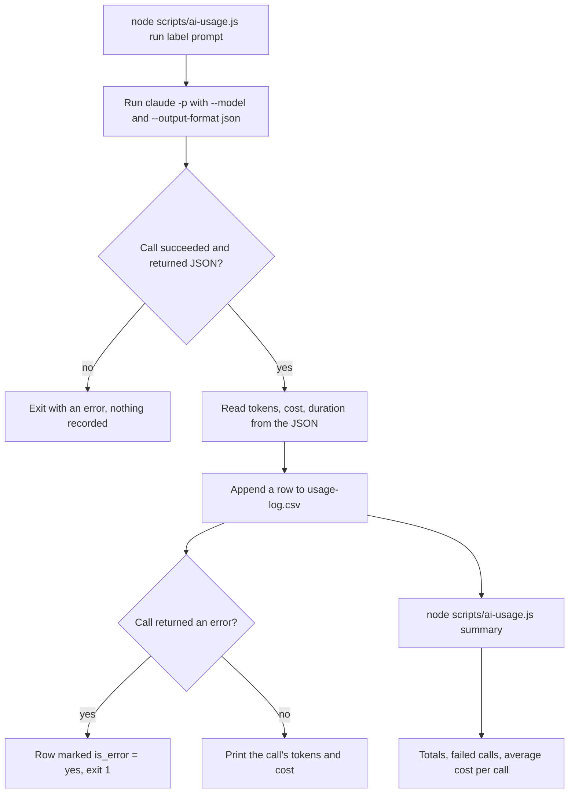

# AI usage and cost log

## Why we added it

The capstone asks for proof that AI use is worth its cost, and for token use per task. Without a record, the claim "AI saved time" has no cost next to it. This log records the tokens and dollar cost of each AI call, so the time saved can be set against the money spent.

## Purpose

[scripts/ai-usage.js](../../scripts/ai-usage.js) runs one Claude Code call and appends a row to [docs/ai-usage/usage-log.csv](../ai-usage/usage-log.csv):

- **Numbers come from Claude Code.** The script reads the token counts and cost from Claude Code's own JSON output, not from estimates.
- **Failures are recorded too.** A call that returns an error is logged with `is_error = yes`, so failures are not hidden.
- **The prompt is not stored.** Prompts can contain test logs or other private data, so only the task label is kept.
- **The model is named explicitly.** Claude Code's default model was unavailable on this machine, so the script passes `--model` (default `claude-haiku-5-5`, or `AI_MODEL`).

## What changed after adding it

- Each AI-assisted task now has a cost next to it in the log.
- `summary` gives the totals for every recorded call.
- The first real call was recorded: 2 input tokens, 4 output tokens, $0.0034 including cache use.

## What it does not do yet

- **Only scripted calls are logged.** Work done in an interactive Claude Code session is not recorded, because the script does not see that session's usage. The log is only as complete as the calls routed through it.
- **No budget limit.** The script records cost; it does not stop a run that goes over a set amount.
- **The first row is a smoke test,** labelled as such, so it can be told apart from real work.

## Where the code lives

- [scripts/ai-usage.js](../../scripts/ai-usage.js)
- [docs/ai-usage/usage-log.csv](../ai-usage/usage-log.csv)
