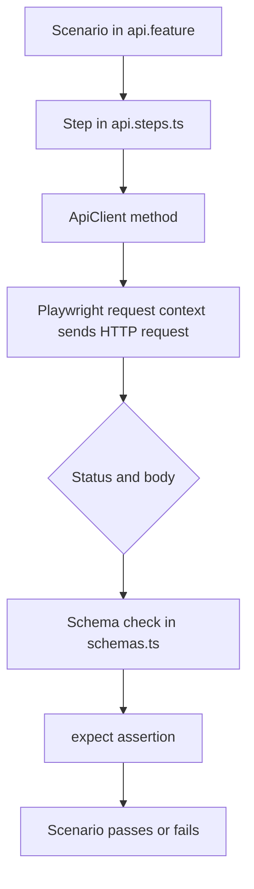

# API tests

## Why we added it

The UI tests only see what the browser shows. An API test checks the backend directly: whether login returns a token, whether an invalid request is rejected, and whether the product data has the right shape. These checks are fast, so they run in well under a second each. The capstone brief also asks for API tests with schema and status checks.

## Purpose

- **API client** (`src/api/ApiClient.ts`): one method per endpoint, such as `login`, `getProducts`, and `get`. Tests never build URLs by hand.
- **Payloads** (`src/api/payloads.ts`): fixed edge-case inputs, such as a missing email, an empty password, and emails at the length limit. The same inputs are used every run.
- **Schema checks** (`src/api/schemas.ts`): hand-written checks for response shape. The library choice (zod or ajv) was left out to avoid a new dependency.
- **Feature file** (`src/features/api.feature`): 36 scenarios covering login, token shape, product data, unknown routes (404), and invalid tokens.

## Why hand-written schema checks

A schema library would be the usual choice. We kept the checks hand-written for now, so the project adds no dependency. If the mentor asks for a library, the switch is one file.

## What changed after adding it

- **Coverage of the backend:** login rules, token handling, and product data are checked without the browser.
- **Speed:** API scenarios take about 0.2s each on average, against 1–3s for the UI.
- **Known gap:** malformed JSON returns HTTP 500 instead of 400. That scenario is tagged as a known defect ([known-defect-tag.md](known-defect-tag.md)).

## Trade-offs

- The payloads are fixed, so they check known edge cases, not random ones.
- Schema checks are only as strict as we wrote them.

## Where the code lives

- [src/features/api.feature](../../src/features/api.feature)
- [src/steps/api.steps.ts](../../src/steps/api.steps.ts)
- [src/api/](../../src/api/)
