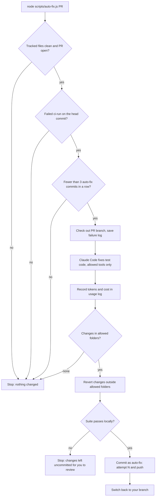

# Guarded auto-fix (run locally)

## Why we added it

A failing CI run needs someone to read the log, find the cause, fix the test, and push. That takes time, and most of it is reading logs. This script does that loop with Claude Code, using your own login, so no API key is stored in the repository. It is the self-healing piece of the capstone's Project 4 scope.

It runs on your machine, when you start it, for one pull request. It does not run in CI.

## Purpose

`GH_TOKEN=$(gh auth token -u riteshbawiskar) node scripts/auto-fix.js <pr-number>` does the following:

1. Finds the failed `ci-run` on the pull request's current commit.
2. Checks out the pull request branch and saves the end of the failing log.
3. Asks Claude Code to fix the test code, with a fixed list of allowed tools.
4. Re-runs the suite itself. If the suite still fails, nothing is committed.
5. Keeps only changes in `src/steps`, `src/pages`, `src/api`, `src/flows`, and `src/utils`. Other changes made by Claude are reverted.
6. Commits as `auto-fix: attempt N`, and pushes to the pull request branch. The push starts a new `ci-run`.
7. Switches back to the branch you were on.

## Guards

- **Attempt limit.** Three `auto-fix:` commits in a row on a branch. After that, a person fixes it.
- **Folder rule.** Only test code in the five allowed folders can be committed. Feature files, test data, CI, config, and `package.json` are never committed.
- **Suite must pass.** The script runs the suite before it commits. A failing suite is never pushed.
- **Your files are safe.** Only changes Claude made to tracked files are reverted. Untracked files, such as `.metadata/`, are never deleted.
- **Personal account only.** The script needs a token for the personal account that owns the repository, so pull requests and pushes go to the right account.

## What changed after adding it

- The loop from failure to fix is one command, instead of reading logs by hand.
- Every call's tokens and cost are recorded in the [usage log](ai-usage-log.md), so the cost of each fix is visible.

## Limits

- It is not automatic. Someone must start it for each failing pull request.
- It is only as good as the model's fix. The suite check stops a fix that does not work, but it cannot judge whether the fix is the right one. Review each auto-fix commit before merging.
- It fixes test code only. A real application bug is reported in the Claude output, not hidden.
- Each attempt costs model usage. The cost is logged.

## Where the code lives

- [scripts/auto-fix.js](../../scripts/auto-fix.js)
- The usage log it writes to: [docs/ai-usage/usage-log.csv](../ai-usage/usage-log.csv)
