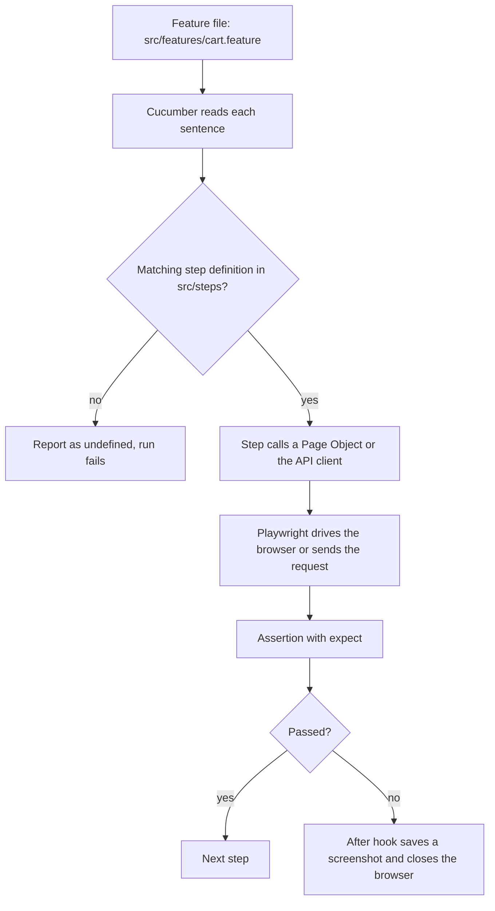

# Cucumber BDD scenarios

## Why we added it

The suite needs test cases that a manager, a tester, or a mentor can read without knowing TypeScript. Before this, the tests were Playwright spec files, and the scenarios existed only as code. Gherkin (`Given / When / Then`) puts each behaviour in a sentence, so the feature files double as the test plan.

The repository now runs Cucumber only. Playwright is used as a library (browser control and the API request client), not as a test runner.

## Purpose

- Each `.feature` file holds scenarios for one area: login, products, cart, checkout, orders, and the API.
- Each sentence is matched to a step definition in `src/steps/`.
- Steps call Page Objects for the browser, or the API client for endpoints.
- Scenario Outlines run the same steps with several data rows, for example the invalid-login cases.

## Per-scenario browser

The `Before` hook opens a new browser for each scenario, and the `After` hook closes it, even when the scenario fails. A failed scenario also gets a screenshot attached to the report. Each scenario therefore starts with a clean browser, which is the basis for parallel runs.

- Code: [src/support/hooks.ts](../../src/support/hooks.ts), [src/support/world.ts](../../src/support/world.ts)

## What we achieved after adding this feature: Cucumber BDD scenarios

- **Readability:** the scenarios can be checked against the business rules without reading code.
- **One runner:** the earlier Playwright specs were removed, so there is one suite to maintain. The scenario count is 82 (42 UI, 40 API).
- **Failure evidence:** each failure has a screenshot in the report.

## Trade-offs

- Gherkin adds a layer: a sentence must match a step, and a new sentence needs a new step.
- Step definitions must stay generic. A step that is too specific gets reused poorly.

## Where the code lives

- Scenarios: [src/features/](../../src/features/)
- Steps: [src/steps/](../../src/steps/)
- Runner settings: [cucumber.js](../../cucumber.js)
