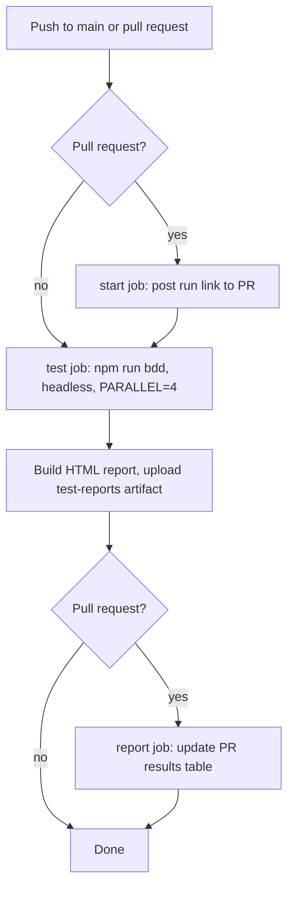

# CI pipeline (`ci-run`)

## Why we added it

Tests that run only on one laptop prove little. The pipeline runs the full suite on every push to `main` and on every pull request, in a clean machine, with the same steps each time. It also gives the team one place to see whether a change is safe.

## Purpose

The workflow is [.github/workflows/ci.yml](../../.github/workflows/ci.yml), named `ci-run`. It has three jobs:

- **start** (pull requests only): posts a link to the running `ci-run` in the pull request description, so the link is there while the tests run.
- **test**: installs Node 22 and Chromium, runs `npm run bdd` headless with 4 parallel workers, builds the HTML report, and uploads the reports as the `test-reports` artifact.
- **report** (pull requests only, runs even when tests fail): reads the results and writes them into the pull request ([PR results table](pr-results-table.md)).

## Why the test job queues

The test job uses a concurrency group. Two runs at once would use the same four worker accounts, and their carts would collide. So a second run waits for the first. The start and report jobs are not queued, so the link and results still post right away.

## What we achieved after adding this feature: CI pipeline (ci-run)

- **Every change is tested** on a clean machine before it is merged.
- **Failures are visible** in the pull request, with a link to the run.
- **Parallel on CI:** the test job runs 4 workers. The run took about 1 minute 15 seconds on GitHub, against about 4 minutes 3 seconds on `main` before parallel runs.

## Limits

- The pipeline does not fix failures. A failing run needs a person to read the log.
- Branch protection (requiring the checks before merge) is a repository setting, not a file in this repo.

## Where the code lives

- [.github/workflows/ci.yml](../../.github/workflows/ci.yml)
- [scripts/generateCucumberReport.js](../../scripts/generateCucumberReport.js)
