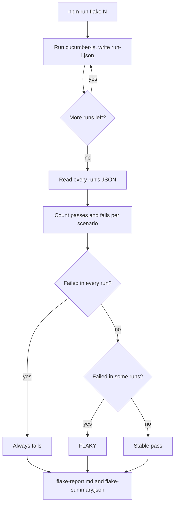

# Flake check

## Why we added it

A scenario that passes once and fails once is a flake, and it is easy to miss. Before this, we measured flakiness by hand, with a few runs of a few tests. The flake check repeats the whole suite and records each scenario's result in every run, so the flaky ones are named and counted.

## Purpose

`npm run flake` runs the Cucumber suite several times (5 by default) and writes a report. Each scenario is sorted into one of three groups:

- **Stable pass:** passed every run.
- **Flaky:** passed in some runs and failed in others.
- **Always fails:** failed every run.

The report is `test-output/flake/flake-report.md`. The exit code is 1 if any scenario failed in any run, so the check can gate a pipeline later.

## What changed after adding it

- **Measured result:** five runs gave 390 scenario runs with no failures, and no flaky scenarios, on the current code.
- **Named flakes:** when a scenario does fail, the report names it and shows how often.

## What it does not show yet

- The flaky verdict has not been tested on a real flaky scenario. Until one is found, the report only proves that the check runs and counts correctly. Five runs is a small sample, so a scenario that fails 1 time in 20 may pass every run here.
- The check runs the suite locally, not on CI.

## Trade-offs

- Each run takes about 30 seconds, so 5 runs take about 2.5 minutes. More runs give a better sample but take longer.

## Where the code lives

- [scripts/flake-check.js](../../scripts/flake-check.js)
- `npm run flake` is defined in [package.json](../../package.json).
