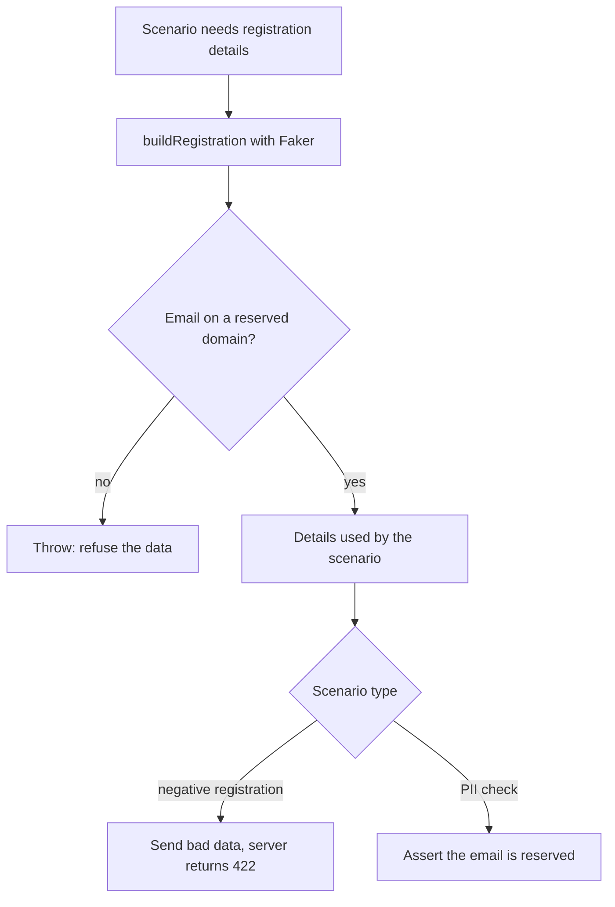

# Generated test data (Faker)

## Why we added it

Hand-typed test data repeats the same few names and emails, which hides edge cases. Registration rules (name length, password length) are easy to test with generated values, and generated data does not need to be copied from real people. Faker produces realistic-looking names and emails on demand, and a rule in the code keeps every email on a reserved domain.

The capstone asks for synthetic data that is PII-safe: no real personal data, and only reserved addresses.

## Purpose

[src/test-data/registrationData.ts](../../src/test-data/registrationData.ts) builds registration details with Faker:

- **Names** are random and checked against the app's rule (3 to 20 letters).
- **Email** always uses `example.com`. Any override that is not a reserved domain is refused before the test runs.
- **Mobile, password, occupation, gender** are fixed to values the app accepts, except the password, which is random.
- **Seeded:** the seed is fixed (`FAKER_SEED` can change it), so a failing run can be repeated with the same values.

## Registration scenarios

Four scenarios in [api.feature](../../src/features/api.feature) use the generator. Each sends data the server must reject, so **no real account is created**:

- A password of 5 characters is rejected (`Password must be 8 Character Long!`).
- A missing first name is rejected (`First Name is required!`).
- A first name of 2 characters is rejected (`First Name must be 3 to 20 characters long!`).
- The generated email uses a reserved domain.

## Checkout data

The checkout form in this app asks only for a country. Faker adds nothing there, so the country stays in [testData.ts](../../src/data/testData.ts). Faker is used where the data has rules to test.

## What we achieved after adding this feature: Generated test data (Faker)

- The suite has 82 scenarios (78 before, plus 4 registration scenarios). All pass.
- Every generated email is checked against the reserved-domain rule.

## Limits

- The valid-registration path is not tested, because it would create a real account on the demo site on every run, and we have no way to delete accounts.
- Generated names are random, so an unusual name could expose a bug the fixed data would not. The seed keeps runs repeatable.

## Where the code lives

- [src/test-data/registrationData.ts](../../src/test-data/registrationData.ts)
- [src/steps/api.steps.ts](../../src/steps/api.steps.ts)
- [src/features/api.feature](../../src/features/api.feature)
