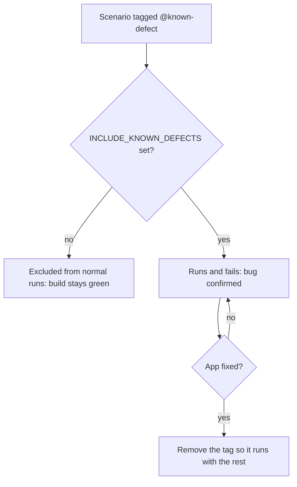

# Known-defect tag

## Why we added it

We found a real bug: malformed JSON sent to the login endpoint returns HTTP 500 instead of 400. If the scenario ran in every build, the build would stay red until the app team fixed it, and a red build hides new failures. If we deleted the scenario, the bug would be forgotten. The tag keeps the scenario, documents the bug, and keeps the build green.

## Purpose

- The scenario carries the `@known-defect` tag in `api.feature`.
- `cucumber.js` excludes that tag from normal runs.
- To run it on purpose: `INCLUDE_KNOWN_DEFECTS=1 npx cucumber-js --tags @known-defect`. It fails, which proves the bug is still there.

## What we achieved after adding this feature: Known-defect tag

- The suite reports 82 scenarios in normal runs, with the known defect excluded.
- The bug is visible in the feature file and in the docs, so it cannot be forgotten.

## Trade-offs

- An excluded scenario can be forgotten. When the app is fixed, someone must remove the tag. The README says so.
- The tag is a judgement: it is for a confirmed product bug, not for a flaky test.

## Where the code lives

- [src/features/api.feature](../../src/features/api.feature)
- [cucumber.js](../../cucumber.js)
