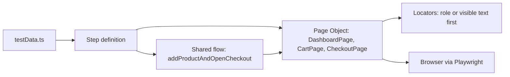

# Page Objects and shared flows

## Why we added it

Without this layer, every step file repeated the same locators. When the app changed one button, the fix had to be made in many places. Page Objects keep each page's locators and actions in one class, and shared flows keep a multi-page journey in one function.

## Purpose

- **Page Objects** (`src/pages/`): one class per page. Locators and actions live there, and steps call methods such as `addProductToCart`.
- **BasePage:** shared helpers, such as waiting for the toast message after an action.
- **Shared flow** (`src/flows/shoppingFlows.ts`): the journey "add a product, open the cart, go to checkout" is written once, and used by cart, checkout, and order steps.
- **Shared test data** (`src/data/testData.ts`): product names, messages, and the checkout country, kept in one place.

## Locator rules we follow

- Prefer role and visible text (`getByRole('button', { name: 'Checkout' })`). Layout and CSS class are the fallback.
- Place Order is an `<a>` link in this app, so it keeps its class `.action__submit`. The reason is noted in the code.
- Country selection uses an **exact** text match. A partial match picked "British Indian Ocean Territory" when the test asked for "India".

## What we achieved after adding this feature: Page Objects and shared flows

- **Fewer edits:** a locator change is now one edit in one class.
- **Fewer wrong matches:** the exact country match fixed a test that picked the wrong country.
- **Clearer failures:** page checks use web-first assertions with a message, so a failure says what was expected.

## Trade-offs

- Page Objects add files, so a small change touches more places.
- A shared flow must not hide a real check. The flow only performs the journey; the scenario still asserts the result.

## Where the code lives

- [src/pages/](../../src/pages/)
- [src/flows/shoppingFlows.ts](../../src/flows/shoppingFlows.ts)
- [src/data/testData.ts](../../src/data/testData.ts)
