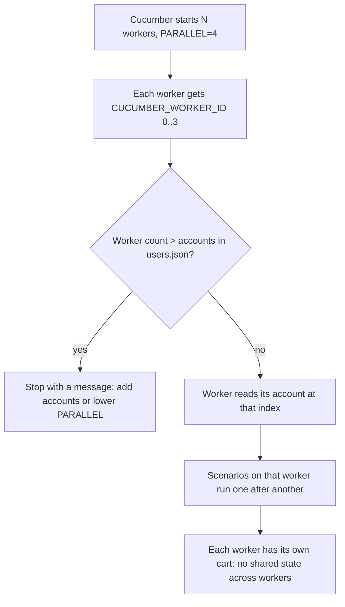

# Parallel workers and test accounts

## Why we added it

The app keeps the cart on the server, per account. Early on, all scenarios logged in as one user, so two scenarios running at once shared one cart. One test's item appeared in another test's cart, and a completed order emptied a cart that another test was still using. The fix at the time was to run one scenario at a time, which made the suite slow (about 97 seconds).

Parallel runs only work when each worker has its own account.

## Purpose

- **Accounts** (`src/test-data/users.json`): four worker accounts with names and emails. No passwords. All accounts use the shared password from `TEST_USER_PASSWORD` in `.env` locally, or the CI secret.
- **Worker pick** (`src/utils/configReader.ts`): Cucumber sets `CUCUMBER_WORKER_ID` for each worker (0, 1, 2, ...). The step code picks the account at that index.
- **Worker count** (`cucumber.js`): `parallel` is set from `PARALLEL`, default 4. `PARALLEL=1` runs serially.
- **Guard:** if the worker count is larger than the number of accounts, the run stops with a clear message.

## Scenarios on the same worker still share a cart

Scenarios on one worker run in sequence, so they share that worker's cart. Scenarios that need a known state must set it up. The cart scenarios empty the cart in a `Given` step, and the Orders scenarios place their own order first.

## What changed after adding it

- **Run time:** the full suite went from about 97s (serial) to about 28s with 4 workers. That is about 3.4 times faster, measured on the same machine.
- **Stability:** three parallel runs in a row all passed 78 of 78. Before the Orders fix, the Orders scenarios failed depending on which scenarios ran first.
- **Serial still works:** `PARALLEL=1` passed 78 of 78.

## Open issues

- **Cart removal:** a removal sometimes does not persist on the server. It appeared once and is not fixed.
- **More workers need more accounts:** the number of workers is limited by the accounts in the file.

## Where the code lives

- [src/test-data/users.json](../../src/test-data/users.json)
- [src/utils/configReader.ts](../../src/utils/configReader.ts)
- [cucumber.js](../../cucumber.js)
