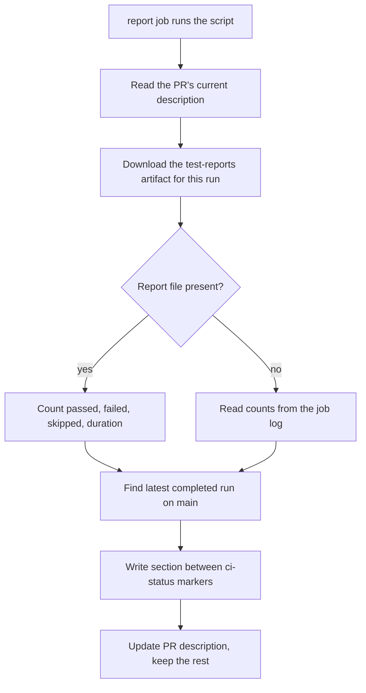

# PR results table

## Why we added it

Reviewers should not have to open the Actions log to know whether a pull request is safe. The results table puts the answer in the pull request description: how many scenarios passed, how long the run took, and how that compares with `main`.

## Purpose

[scripts/pr-ci-status.js](../../scripts/pr-ci-status.js) writes a section at the top of the pull request description, between two markers. Each run replaces only that section, and the rest of the description is kept.

It reads the counts from the `test-reports` artifact (`cucumber-report.json`). If a run has no report file, it falls back to reading the job log. It also finds the latest completed run on `main`, so the table can show a before-and-after comparison.

## What we achieved after adding this feature: PR results table

- The pull request shows the result at the top, with a link to the run labelled `ci-run`.
- The before-and-after table shows the change in run time against `main`. For PR #8 it showed 78 of 78 passing, with the run time going from 4m 03s to 1m 15s.

## Limits

- The script needs the GitHub CLI and a token with pull request write access. Those are set only for the report job.
- Counts come from the report file. If the format of that file changes, the table breaks until the script is updated.

## Where the code lives

- [scripts/pr-ci-status.js](../../scripts/pr-ci-status.js)
- Called from the `report` job in [.github/workflows/ci.yml](../../.github/workflows/ci.yml)
